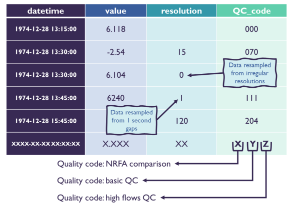

<h1 style="margin: 0px 0px 10px 0px;">UK-FLOW-15: station manipulation toolkit</h1>

<h2 style="margin: 0px; color: #555555; font-weight: normal; font-style: italic;">
Interpolation of data using QC flags
</h2>

# Introduction: UK-FLOW15

**UK-FLOW15** is a quality-controlled, **15-minute** national-scale river flow dataset for the UK, comprising observations from 1,369 gauging stations across England, Scotland, Wales, and Northern Ireland.

Unlike some datasets that include only the cleanest records, UK-FLOW15 has been published in full — every available station and time step is included, regardless of data quality. This is a deliberate decision: data artefacts that are problematic for one type of analysis may be entirely irrelevant for another. For example, low-flow truncation errors do not influence flood frequency analysis, and removing such records would unnecessarily limit the dataset's usefulness.
    
This means that users of UK-Flow 15 must make decisions about which observations are suitable for their analysis, which values to exclude and which to correct. To support users in making informed decisions about data quality, each observation is accompanied by a **QC flag** that describes any issues identified during quality control. 
    
Data is available here: https://catalogue.ceh.ac.uk/datastore/eidchub/211710ac-f01b-4b52-807f-373babb1c368/  
Further information on the dataset is here: https://essd.copernicus.org/preprints/essd-2026-152/essd-2026-152.pdf

---

# Understanding the QC flags

Each observation in UK-FLOW15 is assigned a three-digit QC flag. Each digit corresponds to a separate quality control dimension, as illustrated below:

<!--  -->

| Flag | Dimension | Description |
|---|---|---|
| **X** | Consistency check | Comparison against other established UK hydrological products (NRFA)|
| **Y** | Anomaly check | Standard QC checks for statistical anomalies |
| **Z** | High-flow check | Checks applied during high-flow events |

---    

For each of the three checks, the digit value indicates the nature of the issue. The tables below list the meaning of the range of possible values for each of the three checks.

---    
    
<table style="width: 100%; border-collapse: collapse; font-size: 14px; margin: 20px 0;">

  <!-- Header rows -->
  <thead>
    <tr>
      <th colspan="2" style="background-color: #d0e4f7; border: 1px solid #999; padding: 8px 12px; text-align: center;">X — Consistency check</th>
      <th colspan="2" style="background-color: #d5ecd4; border: 1px solid #999; padding: 8px 12px; text-align: center;">Y — Anomaly check</th>
      <th colspan="2" style="background-color: #fde8cc; border: 1px solid #999; padding: 8px 12px; text-align: center;">Z — High-flow check</th>
    </tr>
    <tr>
      <th style="border: 1px solid #999; padding: 6px 12px; text-align: center;">Code</th>
      <th style="border: 1px solid #999; padding: 6px 12px;">Meaning</th>
      <th style="border: 1px solid #999; padding: 6px 12px; text-align: center;">Code</th>
      <th style="border: 1px solid #999; padding: 6px 12px;">Meaning</th>
      <th style="border: 1px solid #999; padding: 6px 12px; text-align: center;">Code</th>
      <th style="border: 1px solid #999; padding: 6px 12px;">Meaning</th>
    </tr>
  </thead>

  <!-- Body rows — fill in Y and Z meanings to match -->
  <tbody>
    <tr>
      <td style="border: 1px solid #999; padding: 6px 12px; text-align: center;"><strong>0</strong></td>
      <td style="border: 1px solid #999; padding: 6px 12px;">Data is in sufficient agreement with other UK products</td>
      <td style="border: 1px solid #999; padding: 6px 12px; text-align: center;"><strong>0</strong></td>
      <td style="border: 1px solid #999; padding: 6px 12px;">No issues found </td>
      <td style="border: 1px solid #999; padding: 6px 12px; text-align: center;"><strong>0</strong></td>
      <td style="border: 1px solid #999; padding: 6px 12px;">Not a high flow</td>
    </tr>
    <tr>
      <td style="border: 1px solid #999; padding: 6px 12px; text-align: center;"><strong>1</strong></td>
      <td style="border: 1px solid #999; padding: 6px 12px;">Mismatch &gt;5% between 15-min values and NRFA daily values</td>
      <td style="border: 1px solid #999; padding: 6px 12px; text-align: center;"><strong>1</strong></td>
      <td style="border: 1px solid #999; padding: 6px 12px;">Negative value</td>
      <td style="border: 1px solid #999; padding: 6px 12px; text-align: center;"><strong>1</strong></td>
      <td style="border: 1px solid #999; padding: 6px 12px;">Unrealistically high event</td>
    </tr>
    <tr>
      <td style="border: 1px solid #999; padding: 6px 12px; text-align: center;"><strong>2</strong></td>
      <td style="border: 1px solid #999; padding: 6px 12px;">Mismatch &gt;20% between 15-min values and POT values</td>
      <td style="border: 1px solid #999; padding: 6px 12px; text-align: center;"><strong>2</strong></td>
      <td style="border: 1px solid #999; padding: 6px 12px;">Relative spike</td>
      <td style="border: 1px solid #999; padding: 6px 12px; text-align: center;"><strong>2</strong></td>
      <td style="border: 1px solid #999; padding: 6px 12px;">Exceptionally high event </td>
    </tr>
    <tr>
      <td style="border: 1px solid #999; padding: 6px 12px; text-align: center;"><strong>3</strong></td>
      <td style="border: 1px solid #999; padding: 6px 12px;">Mismatch &gt;20% between 15-min values and AMAX values</td>
      <td style="border: 1px solid #999; padding: 6px 12px; text-align: center;"><strong>3</strong></td>
      <td style="border: 1px solid #999; padding: 6px 12px;">Absolute spike </td>
      <td style="border: 1px solid #999; padding: 6px 12px; text-align: center;"><strong>3</strong></td>
      <td style="border: 1px solid #999; padding: 6px 12px;">Event with >0.1 annual likelihood and no antecedent rainfall </td>
    </tr>
    <tr>
      <td style="border: 1px solid #999; padding: 6px 12px; text-align: center;"><strong>4</strong></td>
      <td style="border: 1px solid #999; padding: 6px 12px;">Combination of 1 and 3 — mismatch with both daily and POT values</td>
      <td style="border: 1px solid #999; padding: 6px 12px; text-align: center;"><strong>4</strong></td>
      <td style="border: 1px solid #999; padding: 6px 12px;">Drop</td>
      <td style="border: 1px solid #999; padding: 6px 12px; text-align: center;"><strong>4</strong></td>
      <td style="border: 1px solid #999; padding: 6px 12px;">Event with >0.1 annual likelihood and no concurrent high flow in the hydrometric area </td>
    </tr>
    <tr>
      <td style="border: 1px solid #999; padding: 6px 12px; text-align: center;"><strong>5</strong></td>
      <td style="border: 1px solid #999; padding: 6px 12px;">Combination of 1 and 2 — mismatch with both daily and AMAX values</td>
      <td style="border: 1px solid #999; padding: 6px 12px; text-align: center;"><strong>5</strong></td>
      <td style="border: 1px solid #999; padding: 6px 12px;">Fluctuation</td>
      <td style="border: 1px solid #999; padding: 6px 12px; text-align: center;"><strong>5</strong></td>
      <td style="border: 1px solid #999; padding: 6px 12px;">Combination of 3 and 4 — event with no antecedent rainfall and no concurrent high flow in the hydrometric area </td>
    </tr>
  <tr>
      <td style="border: 1px solid #999; padding: 6px 12px; text-align: center;"><strong>-</strong></td>
      <td style="border: 1px solid #999; padding: 6px 12px;">-</td>
      <td style="border: 1px solid #999; padding: 6px 12px; text-align: center;"><strong>6</strong></td>
      <td style="border: 1px solid #999; padding: 6px 12px;">Truncated low flows</td>
      <td style="border: 1px solid #999; padding: 6px 12px; text-align: center;"><strong>6</strong></td>
      <td style="border: 1px solid #999; padding: 6px 12px;">Event with >0.1 annual likelihood with both antecedent rainfall and concurrent regional high flow - flow is considered "validated" </td>
    </tr>
  <tr>
      <td style="border: 1px solid #999; padding: 6px 12px; text-align: center;"><strong>-</strong></td>
      <td style="border: 1px solid #999; padding: 6px 12px;">-</td>
      <td style="border: 1px solid #999; padding: 6px 12px; text-align: center;"><strong>7</strong></td>
      <td style="border: 1px solid #999; padding: 6px 12px;">Truncated high flows</td>
      <td style="border: 1px solid #999; padding: 6px 12px; text-align: center;"><strong>7</strong></td>
      <td style="border: 1px solid #999; padding: 6px 12px;">Combination of 2 and 3 or 4 — exceptionally high event with no antecedent rainfall or concurrent high flow in the hydrometric area</td>
    </tr>
  <tr>
      <td style="border: 1px solid #999; padding: 6px 12px; text-align: center;"><strong>-</strong></td>
      <td style="border: 1px solid #999; padding: 6px 12px;">-</td>
      <td style="border: 1px solid #999; padding: 6px 12px; text-align: center;"><strong>8</strong></td>
      <td style="border: 1px solid #999; padding: 6px 12px;">Combination of 2 and 3 — relative and absolute spike </td>
      <td style="border: 1px solid #999; padding: 6px 12px; text-align: center;"><strong>8</strong></td>
      <td style="border: 1px solid #999; padding: 6px 12px;">Combination of 2 and 5 - exceptionally high event with no antecedent rainfall & high flows in hydrometric area</td>
    </tr>
  <tr>
      <td style="border: 1px solid #999; padding: 6px 12px; text-align: center;"><strong>-</strong></td>
      <td style="border: 1px solid #999; padding: 6px 12px;">-</td>
      <td style="border: 1px solid #999; padding: 6px 12px; text-align: center;"><strong>9</strong></td>
      <td style="border: 1px solid #999; padding: 6px 12px;">Combination of 4 with 1 or 6 — drop plus negative/truncated low flows</td>
      <td style="border: 1px solid #999; padding: 6px 12px; text-align: center;"><strong>9</strong></td>
      <td style="border: 1px solid #999; padding: 6px 12px;">Combination of 2 and 6 - flow is considered "validated"</td>
    </tr>        
  </tbody>

</table>
   
---
    
<!-- So, for example, a value of 204 means that:
 
- (X): 2 -> Mismatch >20% between 15-min values and POT values (Consistency check against other established UK hydrological products)
- (Y): 0 -> No issues found (Standard QC anomaly checks)
- (Z): 4 -> Event with >0.1 annual likelihood and no concurrent high flow in the hydrometric area (High-flow event checks)  
     -->
    
As an example, a QC flag value of **204** for the timestamp `1974-12-28 15:45:00` is interpreted as follows: the **X digit (2)** indicates a mismatch of more than 20% between the 15-minute values and POT values; the **Y digit (0)** indicates no anomalies were detected; and the **Z digit (4)** indicates a high-flow event with greater than 0.1 annual exceedance probability and no concurrent high flow recorded in the hydrometric area.    
    
---    
    
# Worked example: interpolating high-flow artefacts

This notebook walks through an example of the full process of identifying and replacing spurious high-flow values using the **Z dimension** of the QC flag. The station used here has been selected because it contains a small number of clearly flagged spike artefacts, making it a clean illustration of the method.

The process follows four steps:

1. **Load the data** — read in the 15-minute flow time series and its associated QC flags for a single station
2. **Identify flagged values** — locate observations where the Z flag exceeds an acceptable threshold, indicating a likely high-flow artefact
3. **Interpolate** — replace those flagged values with estimates derived from the nearest unflagged observations on either side
4. **Inspect the result** — plot the original and cleaned time series together to verify that the interpolation looks reasonable

Work through each cell in order. Where choices need to be made — such as which Z flag threshold to apply — these are clearly signposted and explained.    

## Interpolation

### Why interpolate?

For many applications — such as computing continuous flow statistics, fitting hydrological models, or analysing storm events — a complete, unbroken time series is essential. Simply deleting flagged observations would leave gaps in the record that could distort results or prevent analysis entirely.

Interpolation offers a practical middle ground: flagged values that are likely to be spurious are replaced with estimates derived from the surrounding unflagged observations. This preserves the continuity of the time series while removing the influence of known artefacts. The approach demonstrated in this notebook focuses specifically on **high-flow event artefacts**, identified using the **Z dimension** of the QC flag (described below), which captures anomalous spikes in flow that are inconsistent with conditions observed elsewhere in the hydrometric network.

It is worth noting that interpolation is not always appropriate — for example, if large portions of a record are flagged, interpolated values may be unreliable. Users should always inspect their data before and after applying any QC procedure.

